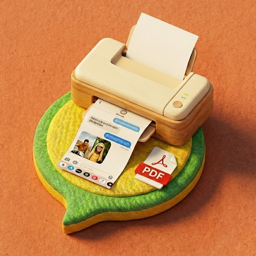

<p align="center">
  
</p>

# iMessagePrinter

Export any iMessage, SMS, or RCS conversation to a formatted PDF or an editable Word document — complete with timestamps, delivery/read receipts, reactions, contact names, and inline images.

## What You Get

- **Full conversation history** going back to 2012
- **Contact name resolution** via your Contacts app
- **All metadata**: timestamps, read/delivered receipts, reactions, edit status, service type, thread replies
- **Inline images** with three export options: full resolution, 640x480 thumbnails, or text-only
- **Cover page** with conversation summary (participants, message count, date range)
- **Page numbers** and conversation name in the footer
- **Word export** with real headings (conversation and month), date separators, and one editable paragraph per message, so you can search and highlight text
- **Modal exports** with message and image counts, an estimated time remaining, and a Cancel button; only one export runs at a time

## Requirements

- macOS 14 (Sonoma) or later
- Full Disk Access (to read `~/Library/Messages/chat.db`)
- Xcode Command Line Tools (`xcode-select --install`)

## Build & Run

```bash
make bundle   # builds release + creates iMessagePrinter.app
make run      # builds + launches
```

Other targets:

```bash
make build    # release build only
make clean    # remove build artifacts
```

## First Launch

1. **Launch the app** — it will ask for Full Disk Access
2. **Open Privacy Settings** — click the button in the app, or go to System Settings > Privacy & Security > Full Disk Access
3. **Add the app** — click the `+` button, find `iMessagePrinter.app`, and toggle it on
4. **Relaunch** — quit and reopen the app (or click "I've Granted Access")

The app will also request Contacts access to resolve phone numbers and emails to names. This is optional — without it, you'll see raw phone numbers instead.

## Using the App

- **Sidebar**: all your conversations, sorted by most recent. Use the search bar to filter by name or phone number.
- **Detail view**: click a conversation to see the full message log with all metadata.
- **Export**: click the Export menu in the toolbar and choose **Export PDF…** or **Export Word Document…**. Both formats export the selected conversation only. A save dialog appears with an **Images** dropdown:
  - **No images** — smallest file, text placeholders for all images
  - **Thumbnails (640x480)** — good balance of quality and file size
  - **Full resolution** — every image at original size (can produce very large files)

After you choose a destination, the export runs in a modal panel with progress, message and image counts, and an estimated time remaining. Cancel stops the export and removes the partial file. Changing the selected conversation or starting another export while one runs does not affect the export in progress.

## Performance

On a 10,885-message conversation with 750 images, the current release exports in about 0.2 seconds with no images, 19 seconds with thumbnails, and 10 seconds at full resolution. See [the benchmark](docs/superpowers/benchmarks/2026-11-24-docx.md) for the before/after numbers.

## How It Works

iMessagePrinter reads your local Messages database (`~/Library/Messages/chat.db`) in read-only mode. It never modifies your messages. The app is not sandboxed, which is why it needs Full Disk Access granted manually.

Messages are parsed from Apple's `attributedBody` binary format (typedstream) since most modern messages store their text there rather than in the plain `text` column. Contact names are resolved by building a lookup table from your Contacts database at launch.

## Project Structure

```
Sources/iMessagePrinter/
  App/           App entry point and state management
  Models/        GRDB database records and display models
  Services/      Database queries, contact resolution, body parsing, PDF export
  Services/Export/  Shared export models, planner, Word writer/packager, image preparation
  Views/         SwiftUI views (sidebar, detail, onboarding)
  Utilities/     Date formatting helpers
```

## License

MIT
